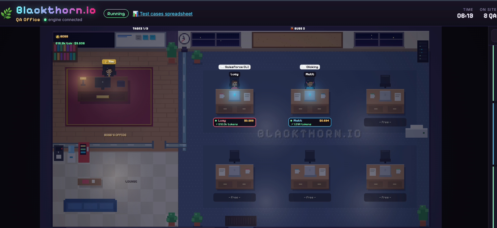

# Blackthorn.io · QA Office 🌿

A pixel-art office where real QA agents (Claude Agent SDK + Playwright) test a link following your rules, ask each other questions, and escalate important decisions to you, the boss.



## Run

```bash
pnpm install
pnpm dev          # engine on :8787 + web on :5173
```

Open http://localhost:5173 → **New mission** → test cases spreadsheet link + mission instructions + number of testers.

### Mission inputs
- **Test cases**: a Google Sheets link. Agents read it through your **claude.ai Google Sheets connector** (read-only: `get_spreadsheet`, `get_values`). The boss hands out case IDs; each tester reads its own rows.
- **Mission instructions**: scope (tab, categories, case IDs), app URL and the **Salesforce org alias**. Nothing is hardcoded; if the scope is unclear the boss asks you.
- **Salesforce**: agents use your already-authenticated `sf` CLI alias through a restricted `salesforce_cli` tool (allowlist: `data query/get/search/create/update`, `org open/list`, `sobject describe/list`, `apex list/get`). `org open` is forced to `--url-only` and opened in the agent's own browser.

### Security model
- Agents never get Bash: Claude Code auto-approves read-only shell commands, which could read local secrets.
- claude.ai connectors (Gmail, Slack, Drive...) reach every SDK session; everything except the two Sheets read tools is denied.

**Auth**: the Agent SDK uses your Claude Code login or `ANTHROPIC_API_KEY`.
**Browser**: Playwright MCP uses your Google Chrome (`PW_BROWSER=chromium` if you don't have it; `PW_HEADED=1` to watch the browsers).

## Architecture

```
shared/events.ts     event contract (the only shared piece)
server/              engine: real agents, orchestration, token accounting
  mission.ts         lifecycle: arrives → boss → desk → works → comes back → leaves
  agents/boss.ts     plans, advises, escalates to you (escalate_to_human)
  agents/qa.ts       tester tools: report_bug, ask_colleague, ask_boss, complete_task
  agents/runAgent.ts query() wrapper with live token counting (deltas)
  humanDesk.ts       pending decisions that block the agent until you answer
web/                 visualizer: only renders events, knows nothing about QA
  game/              pixel-art canvas: map, A*, procedural sprites, lighting
  components/        React HUD: bugs, tasks, chat, team, decision inbox
rules/               default team rules
runs/<missionId>/    Playwright outputs per agent
```

## Environment variables

| Var | Default |
|---|---|
| `BOSS_MODEL` / `QA_MODEL` | `claude-opus-5-5` |
| `QA_MAX_TURNS` | `60` |
| `PW_BROWSER` | `chrome` |
| `PW_HEADED` | — (`1` = visible browsers) |
